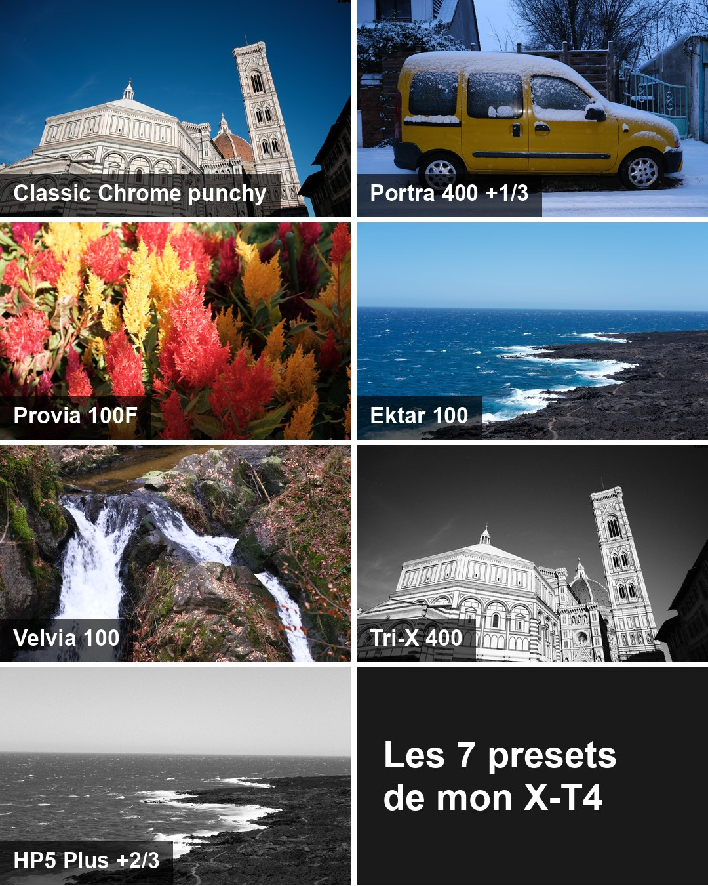

**English** | [Français](README.fr.md)

# Presets Fujifilm

Fujifilm film simulation recipes and presets for X-series and GFX cameras, to use in Fuji X RAW Studio or, on an X-T4 and a Mac, to write straight into the C1 to C7 custom settings.

**Version 2, October 2026**: 14 recipes measured on an X-T4, my 7 current profiles, and all the files converted for the common cameras. The 161 recipes from 2022 are still there.

## Download

| Pack | What it contains | Size |
|---|---|---|
| **[Pack V2 lite](https://github.com/ThomasHMD/fuji-xrfc-preset-generator/releases/latest/download/presets-v2-lite.zip)** | my 7 profiles and the 14 measured recipes, for each camera | 0.3 MB |
| **[Pack V2 complet](https://github.com/ThomasHMD/fuji-xrfc-preset-generator/releases/latest/download/presets-v2-complet.zip)** | the lite pack, the 161 recipes from 2022, the spreadsheet and all the documentation as PDF | 10.8 MB |

Cameras: X-T2, X-T3, X-T4, X-T5, X-T20, X-T30, X-T50, X-H1, X-S10, X-E3, X-Pro2, X-Pro3, X100F, X100V, GFX 50R, GFX 50S and GFX 100. I only tested the X-T4.

The [spreadsheet alone](https://github.com/ThomasHMD/fuji-xrfc-preset-generator/releases/latest/download/DemoPresetV1.1.xlsm) lets you generate your own presets. All versions are in the [Releases](https://github.com/ThomasHMD/fuji-xrfc-preset-generator/releases).

## Getting started

1. In the pack, open the folder for your camera.
2. Copy the `.FP1` files into the X RAW Studio folder:
   - Mac: `~/Library/Application Support/com.fujifilm.denji/X RAW STUDIO/`
   - Windows: `C:\Users\<your-name>\AppData\Local\com.fujifilm.denji\X_RAW_STUDIO\`
3. Connect the camera over USB, in RAW CONV./BACKUP RESTORE mode: the presets appear under *Develop with parameters* (*Développer avec paramètres* in the French interface).

These paths were noted in 2022 and may change depending on your version.

On an X-T4 with a Mac, you can also write a recipe straight into C1 to C7, without X RAW Studio: [see the guide](docs/ecrire-dans-c1-c7.md) (in French). Writing to the camera is not without risk: read the [disclaimer](#disclaimer) first.

## Documentation

The pages below are in French.

| Page | What you will find |
|---|---|
| [The 2026 recipes](docs/recettes-2026.md) | the 14 recipes, my 7 profiles, their settings and their results |
| [What each X-T4 setting does](docs/traitement-couleur-x-t4.md) | simulations, tones, color, white balance, grain: measured, with one figure per setting |
| [Writing a recipe into C1 to C7](docs/ecrire-dans-c1-c7.md) | the Mac tool, step by step |
| [The measurement method](docs/methode.md) | how the recipes are chosen, and how to replay the measurement |
| [The spreadsheet and X RAW Studio](docs/tableur-et-x-raw-studio.md) | generating your presets, importing them, adapting them to another camera |
| [The `.FP1` format](docs/format-fp1.md) | the structure of the file, each field of the spreadsheet |
| [The v1 documentation](docs/documentation-v1.md) | the 2022 docs: manual conversion, community tools |
| [Contributing](docs/contribuer.md) | the authors of the presets, ideas for what comes next |

The [Presets Fujifilm](https://dev.thomashammoudi.com/projets/presets-fuji/) page tells how the pack is made, with the link to the examples. To go further: [FujiXWeekly](https://fujixweekly.com/), the source of most of the `RR` presets, [Henri-Pierre Chavaz's blog](https://hpchavaz-photography.blogspot.com/p/fujifims.html), and [retro-ingenierie-boitiers](https://github.com/ThomasHMD/retro-ingenierie-boitiers), the same measurement method applied to Nikon cameras and a Pentax.

## The repository

| Folder | Contents |
|---|---|
| [`presets/`](presets/) | the `.FP1` files for the X-T4: `mes-7-profils/`, `recettes-2026/` and `recettes-2022/` |
| [`tableur/`](tableur/) | the Excel spreadsheet and its macro |
| [`outils/x-t4/`](outils/x-t4/) | the code of the writing tool and of the measurement chain |
| [`docs/`](docs/) | all the documentation |
| [`archives/`](archives/) | the January 2022 version and the presets shared on the Discord |

The files for the other cameras are in the packs.

## History

- **January 2022, V1**: a spreadsheet and its macro build the `.FP1` files in bulk, with 161 recipes from FujiXWeekly, Henri-Pierre Chavaz, the Discord and me. That is what [the video](https://www.youtube.com/watch?v=j8YM1vs0g2Y) shows.
- **V1.1**: the fix for white balance in Kelvin.
- **April 2026**: the project arrives on GitHub.
- **October 2026, V2**: the recipes are measured on the camera, a Mac tool writes them into C1 to C7, and everything is converted for the other cameras.
- **November 2026, V2.1**: the X-T50 joins the packs, based on the files converted by Didier C. on a real X-T50 profile.

## Credits

The writing tool and the measurement chain build on the work of public projects, cited in each file and detailed in [`LICENCES-TIERS.md`](LICENCES-TIERS.md):

- [FilmKit](https://github.com/eggricesoy/filmkit) (eggricesoy, MIT): the USB sequence for converting a RAF in the camera and the `0xD185` profile;
- [fujifilm-ptp-recipes](https://github.com/ILFforever/fujifilm-ptp-recipes) (Fuji PTP Recipes contributors, documentation CC BY 4.0, code MIT) and [fujifilm-ptp-reference](https://github.com/zgrimz/fujifilm-ptp-reference) (zgrimz, CC BY 4.0): the C1-C7 custom settings and their encoding;
- [libgphoto2](https://github.com/gphoto/libgphoto2) (LGPL-2.1): the readout of the X-T4 properties;
- [spektrafilm](https://github.com/andreavolpato/spektrafilm) (Andrea Volpato): film modeling powered by spektrafilm, for the Provia, Ektar, Velvia, Ektachrome and Kodachrome targets;
- [Imaging Resource](https://www.imaging-resource.com/): the X-T3 and X-T30 test charts used to adjust the scene matrix;
- [colour-science](https://github.com/colour-science/colour), [rawpy](https://github.com/letmaik/rawpy) / [LibRaw](https://www.libraw.org/), [OpenCV](https://opencv.org/), NumPy, SciPy, Pillow, [ExifTool](https://exiftool.org/), and the Robertson table from Adobe's DNG SDK;
- tool written for interoperability, based on these public projects and on tests with my X-T4; no Fujifilm code is copied here.

## License

The whole repository, recipes, spreadsheets, packs, texts, figures and code (`outils/x-t4/`), is under **Creative Commons Attribution-NonCommercial 4.0 International (CC BY-NC 4.0)**, see [`LICENSE`](./LICENSE). Each code file says so in its header.

**Except the photos**: the plates and the grid in `docs/figures/` and the preview image are © Thomas Hammoudi, all rights reserved, outside the CC BY-NC 4.0 license. The screenshots in the documentation (`docs/figures/documentation-v1/`) remain under CC BY-NC 4.0, like the code, the texts and the analyses.

**In plain terms**: you can use, share, modify and redistribute the presets and the generator **freely for non-commercial use**, as long as you **credit the authors** (attribution by prefix, see [Contributing](docs/contribuer.md)). Any commercial use (reselling the pack, building it into a paid product, etc.) is **forbidden** without explicit agreement. The code in `outils/x-t4/` follows the same rule.

The **preset recipes** (parameter values) are settings published by their respective authors (see [Contributing](docs/contribuer.md)). They were compiled from public sources (FujiXWeekly, blogs, the French-speaking Team Fuji Discord). If you are the author of a preset and want it removed or its attribution corrected, open an issue.

The licenses of the third-party sources (including the CC BY-SA 4.0 license of the spektrafilm profiles, which the target tables take on if you build them) are in [`LICENCES-TIERS.md`](LICENCES-TIERS.md).

## Disclaimer

Independent project, **not affiliated with Fujifilm Corporation**. "Fujifilm", "Fuji X RAW Studio", "Provia", "Velvia", "Astia", "Acros", "Eterna", "Classic Chrome", "Classic Negative" and the camera names are trademarks of Fujifilm Corporation; Kodak, Tri-X, Portra, Ektar, Ektachrome, Kodachrome, Ilford, HP5 and FP4 are trademarks of their owners. The film names designate the look being aimed for, not a product.

This project **does not redistribute the Fuji X RAW Studio binary, nor any Fujifilm code**. The spreadsheet generates XML files in the format read by XRFC.

**The `xt4_recettes` tool writes to your camera.** It is provided as is, **without warranty of any kind**, and I cannot be held responsible for a lost setting or a camera that misbehaves. Fujifilm warns that an individual who controls their camera through its SDK may lose the warranty; this tool does not use Fujifilm's SDK, but it talks to the camera over the same protocol. Make a full backup with the official application before the first try, write one slot at a time, check it in the menu, and connect only one X-T4.

**During the measurements**, the camera develops thousands of RAF files in a row. During my 2026 run, it froze three times, always during long series with the profile white balance forced, and it restarted after being switched off and on. Without forced white balance, more than 20,000 conversions in a row went through without incident, and 300 forced conversions afterwards blocked nothing. The most likely cause is a firmware leak when the profile white balance is forced; it is not proven.
