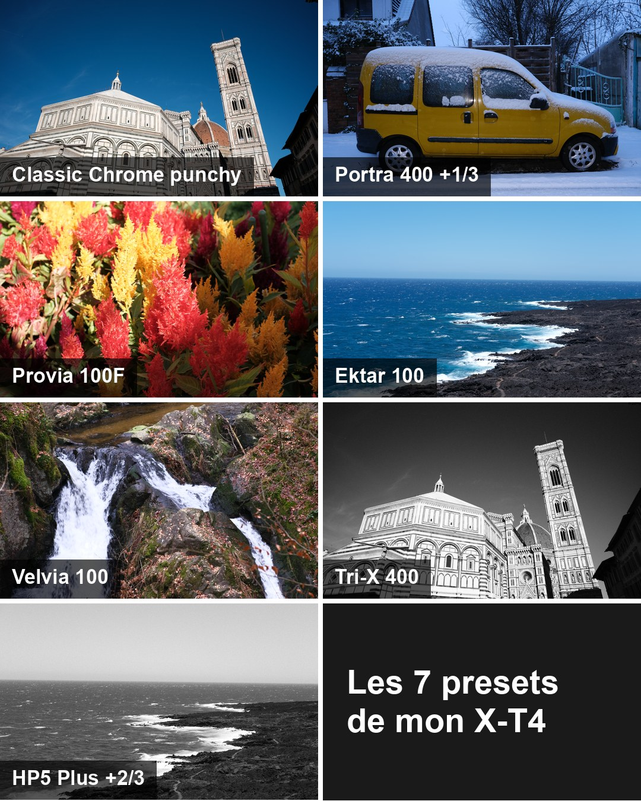

# Presets Fujifilm

Des presets pour les boîtiers Fujifilm, à utiliser dans X RAW Studio ou, sur un X-T4 et un Mac, à écrire directement dans les réglages perso C1 à C7.

**Version 2, octobre 2026** : 14 recettes mesurées sur un X-T4, mes 7 profils du moment, et tous les fichiers convertis pour les boîtiers courants. Les 161 recettes de 2022 sont toujours là.

## Télécharger

| Pack | Ce qu'il contient | Poids |
|---|---|---|
| **[Pack V2 lite](https://github.com/ThomasHMD/fuji-xrfc-preset-generator/releases/latest/download/presets-v2-lite.zip)** | mes 7 profils et les 14 recettes mesurées, pour chaque boîtier | 0,3 Mo |
| **[Pack V2 complet](https://github.com/ThomasHMD/fuji-xrfc-preset-generator/releases/latest/download/presets-v2-complet.zip)** | le pack lite, les 161 recettes de 2022, le tableur et toute la documentation en PDF | 10,7 Mo |

Boîtiers : X-T2, X-T3, X-T4, X-T5, X-T20, X-T30, X-H1, X-S10, X-E3, X-Pro2, X-Pro3, X100F, X100V, GFX 50R, GFX 50S et GFX 100. Je n'ai testé que le X-T4.

Le [tableur seul](https://github.com/ThomasHMD/fuji-xrfc-preset-generator/releases/latest/download/DemoPresetV1.1.xlsm) sert à générer vos propres presets. Toutes les versions sont dans les [Releases](https://github.com/ThomasHMD/fuji-xrfc-preset-generator/releases).

## Démarrer

1. Dans le pack, ouvrez le dossier de votre boîtier.
2. Copiez les fichiers `.FP1` dans le dossier de X RAW Studio :
   - Mac : `~/Library/Application Support/com.fujifilm.denji/X RAW STUDIO/`
   - Windows : `C:\Users\<votre-nom>\AppData\Local\com.fujifilm.denji\X_RAW_STUDIO\`
3. Branchez le boîtier en USB, en mode RAW CONV./BACKUP RESTORE : les presets apparaissent dans *Développer avec paramètres*.

Ces chemins ont été relevés en 2022 et peuvent changer selon votre version.

Sur un X-T4 avec un Mac, vous pouvez aussi écrire une recette directement dans C1 à C7, sans X RAW Studio : [voir le guide](docs/ecrire-dans-c1-c7.md). Écrire dans le boîtier n'est pas sans risque : lisez l'[avertissement](#avertissement) avant.

## Documentation

| Page | Ce qu'on y trouve |
|---|---|
| [Les recettes de 2026](docs/recettes-2026.md) | les 14 recettes, mes 7 profils, leurs réglages et leurs résultats |
| [Ce que fait chaque réglage du X-T4](docs/traitement-couleur-x-t4.md) | simulations, tons, couleur, balance, grain : mesurés, avec une figure par réglage |
| [Écrire une recette dans C1 à C7](docs/ecrire-dans-c1-c7.md) | l'outil pour Mac, pas à pas |
| [La méthode de mesure](docs/methode.md) | comment les recettes sont choisies, et comment rejouer la mesure |
| [Le tableur et X RAW Studio](docs/tableur-et-x-raw-studio.md) | générer ses presets, les importer, les adapter à un autre boîtier |
| [Le format `.FP1`](docs/format-fp1.md) | la structure du fichier, chaque champ du tableur |
| [La documentation de la v1](docs/documentation-v1.md) | la doc de 2022 : conversion à la main, outils de la communauté |
| [Contribuer](docs/contribuer.md) | les auteurs des presets, les pistes d'évolution |

La page [Presets Fujifilm](https://thomashammoudi.com/presets-fujifilm/) du blog présente aussi le pack, avec des exemples. Pour aller plus loin : [FujiXWeekly](https://fujixweekly.com/), source de la plupart des presets `RR`, [le blog d'Henri-Pierre Chavaz](https://hpchavaz-photography.blogspot.com/p/fujifims.html), et [retro-ingenierie-boitiers](https://github.com/ThomasHMD/retro-ingenierie-boitiers), la même méthode de mesure sur des Nikon et un Pentax.

## Le dépôt

| Dossier | Contenu |
|---|---|
| [`presets/`](presets/) | les `.FP1` pour X-T4 : `mes-7-profils/`, `recettes-2026/` et `recettes-2022/` |
| [`tableur/`](tableur/) | le tableur Excel et sa macro |
| [`outils/x-t4/`](outils/x-t4/) | le code de l'outil d'écriture et de la chaîne de mesure |
| [`docs/`](docs/) | toute la documentation |
| [`archives/`](archives/) | la version de janvier 2022 et les presets partagés sur le Discord |

Les fichiers pour les autres boîtiers sont dans les packs.

## Historique

- **Janvier 2022, V1** : un tableur et sa macro fabriquent les `.FP1` en lot, avec 161 recettes de FujiXWeekly, d'Henri-Pierre Chavaz, du Discord et de moi. C'est ce que montre [la vidéo](https://www.youtube.com/watch?v=j8YM1vs0g2Y).
- **V1.1** : le correctif de la balance des blancs en Kelvin.
- **Avril 2026** : le projet arrive sur GitHub.
- **Octobre 2026, V2** : les recettes sont mesurées sur le boîtier, un outil pour Mac les écrit dans C1 à C7, et tout est converti pour les autres boîtiers.

## Crédits

L'outil d'écriture et la chaîne de mesure s'appuient sur le travail de projets publics, cités dans chaque fichier et détaillés dans [`LICENCES-TIERS.md`](LICENCES-TIERS.md) :

- [FilmKit](https://github.com/eggricesoy/filmkit) (eggricesoy, MIT) : la séquence USB de conversion d'un RAF par le boîtier et le profil `0xD185` ;
- [fujifilm-ptp-recipes](https://github.com/ILFforever/fujifilm-ptp-recipes) (Fuji PTP Recipes contributors, documentation CC BY 4.0, code MIT) et [fujifilm-ptp-reference](https://github.com/zgrimz/fujifilm-ptp-reference) (zgrimz, CC BY 4.0) : les réglages perso C1-C7 et leur encodage ;
- [libgphoto2](https://github.com/gphoto/libgphoto2) (LGPL-2.1) : le relevé des propriétés du X-T4 ;
- [spektrafilm](https://github.com/andreavolpato/spektrafilm) (Andrea Volpato) : film modeling powered by spektrafilm, pour les cibles Provia, Ektar, Velvia, Ektachrome et Kodachrome ;
- [Imaging Resource](https://www.imaging-resource.com/) : les mires du X-T3 et du X-T30 qui ont servi à ajuster la matrice de la scène ;
- [colour-science](https://github.com/colour-science/colour), [rawpy](https://github.com/letmaik/rawpy) / [LibRaw](https://www.libraw.org/), [OpenCV](https://opencv.org/), NumPy, SciPy, Pillow, [ExifTool](https://exiftool.org/), et la table de Robertson du SDK DNG d'Adobe ;
- outil écrit à des fins d'interopérabilité, d'après ces projets publics et des essais sur mon X-T4 ; aucun code de Fujifilm n'est copié ici.

## Licence

Tout le dépôt, recettes, tableurs, packs, textes, figures et code (`outils/x-t4/`), est sous **Creative Commons Attribution-NonCommercial 4.0 International (CC BY-NC 4.0)**, cf. [`LICENSE`](./LICENSE). Chaque fichier de code le dit dans son en-tête.

**En clair** : vous pouvez utiliser, partager, modifier et redistribuer les presets et le générateur **librement pour un usage non commercial**, à condition de **créditer les auteurs** (attribution par préfixe, voir [Contribuer](docs/contribuer.md)). Tout usage commercial (revente du pack, intégration dans un produit payant, etc.) est **interdit** sans accord explicite. Le code de `outils/x-t4/` suit la même règle.

Les **recettes de presets** (valeurs de paramètres) sont des réglages publiés par leurs auteurs respectifs (voir [Contribuer](docs/contribuer.md)). Elles ont été compilées depuis des sources publiques (FujiXWeekly, blogs, Discord francophone Team Fuji). Si vous êtes l'auteur d'un preset et souhaitez un retrait ou une correction d'attribution, ouvrir une issue.

Les licences des sources tierces (dont la licence CC BY-SA 4.0 des profils de spektrafilm, que les tables de cible prennent si vous les fabriquez) sont dans [`LICENCES-TIERS.md`](LICENCES-TIERS.md).

## Avertissement

Projet indépendant, **non affilié à Fujifilm Corporation**. « Fujifilm », « Fuji X RAW Studio », « Provia », « Velvia », « Astia », « Acros », « Eterna », « Classic Chrome », « Classic Negative » et les noms de boîtiers sont des marques de Fujifilm Corporation ; Kodak, Tri-X, Portra, Ektar, Ektachrome, Kodachrome, Ilford, HP5 et FP4 sont des marques de leurs propriétaires. Les noms de films désignent le rendu visé, pas un produit.

Ce projet **ne redistribue ni le binaire Fuji X RAW Studio, ni aucun code Fujifilm**. Le tableur génère des fichiers XML au format lu par XRFC.

**L'outil `xt4_recettes` écrit dans votre boîtier.** Il est fourni tel quel, **sans garantie d'aucune sorte**, et je ne peux pas être tenu responsable d'un réglage perdu ou d'un boîtier qui se comporterait mal. Fujifilm prévient qu'un particulier qui contrôle son boîtier par son SDK peut perdre la garantie ; cet outil n'utilise pas le SDK de Fujifilm, mais il parle au boîtier par le même protocole. Faites une sauvegarde complète avec l'application officielle avant le premier essai, écrivez un emplacement à la fois, vérifiez-le dans le menu, et ne branchez qu'un X-T4.

**Pendant les mesures**, le boîtier développe des milliers de RAF à la suite. Pendant ma passe de 2026, il s'est figé trois fois, toujours pendant de longues séries à balance du profil forcée, et il est reparti après extinction et rallumage. Sans balance forcée, plus de 20 000 conversions d'affilée sont passées sans incident, et 300 conversions forcées ensuite n'ont rien bloqué. La cause la plus probable est une fuite du firmware quand la balance du profil est forcée ; elle n'est pas prouvée.
