# Documentation des presets Fujifilm, version 1 (2022)

Cette page regroupe ce qu'il faut savoir pour importer et échanger des presets Fujifilm (fichiers `.FP1`) : où les trouver, comment les adapter à votre boîtier, et les outils de la communauté. Elle reprend la documentation que je tenais sur Notion depuis 2022.

Pour les nouveautés de 2026, voir [la page des presets](https://thomashammoudi.com/presets-fujifilm/), le [README](../README.md) et [le traitement couleur du X-T4](traitement-couleur-x-t4.md).

## Sommaire

- [L'origine de l'idée](#lorigine-de-lidée)
- [Le résultat de base, sur X-T4](#le-résultat-de-base-sur-x-t4)
- [Retrouver les fichiers FP1](#retrouver-les-fichiers-fp1)
- [Téléchargements](#téléchargements)
- [Procédure pour les autres appareils](#procédure-pour-les-autres-appareils)
- [Autres corrections](#autres-corrections)
- [Données par appareil](#données-par-appareil)
- [Utiliser les presets d'un autre appareil dans Lightroom](#utiliser-les-presets-dun-autre-appareil-dans-lightroom)
- [Les outils](#les-outils)
- [Le travail d'Henri-Pierre Chavaz](#le-travail-dhenri-pierre-chavaz)
- [Pour le X-T5](#pour-le-x-t5)
- [Contribuer](#contribuer)

## L'origine de l'idée

L'idée de base vient d'[une discussion sur Twitter](https://twitter.com/eiffair/status/1479539552805085189). On s'est rendu compte qu'il était peut-être possible d'automatiser la saisie des « recettes » Fujifilm.

On trouve ces recettes sur des sites comme [Fuji X Weekly](https://fujixweekly.com/), ou dans [cette liste de 80 recettes](https://www.fujirumors.com/this-pdf-lists-80-fujifilm-film-simulation-custom-profiles-you-can-try-out-yourself/).

## Le résultat de base, sur X-T4

La vidéo de présentation : [youtu.be/j8YM1vs0g2Y](https://youtu.be/j8YM1vs0g2Y).

Resume in English 🇬🇧

So, it's quite simple actually. Here are the main steps:

1. I own a Fuji, I love recipes, but they're a pain to put into the camera and to test. So I looked for a way to make this process much faster.
2. I opened X RAW Studio and realized two things: you can save presets on the computer, and you can import presets from the computer to the camera.
3. I went to see the files saved on the computer: they are FP1 files, which are plain XML files.
4. I started an analysis, to map "how a human notes the recipes" to "how they are noted by Fujifilm in the XML file". It took a while, but I managed to do this mapping.
5. Then the code comes in. On one side, I have an Excel table with all the recipes in "Fujifilm language", and on the other side an XML file. A friend of mine made an Excel macro in Visual Basic: for each line of the file, it generates a FP1 file with the right settings.
6. From there, we put them in the right directory, we open X RAW Studio, and there are 167 presets available, without having to enter them manually.
7. Presets are specific to a camera model. To put the one of an X-T4 on an X-T2, you have to change the name in the XML, which Notepad++ makes quick.

So, thanks to this solution, we can:

- import a lot of presets in X RAW Studio in a few clicks;
- test them directly on RAW files, and import the best ones into the camera;
- exchange presets (FP1 files) easily between users.

## Retrouver les fichiers FP1

Les chemins ci-dessous ont été relevés en 2022 : ils peuvent changer selon la version de X RAW Studio et votre système.

**Windows** : `C:\Users\<votre-nom>\AppData\Local\com.fujifilm.denji\X_RAW_STUDIO\`

**Mac** : `~/Library/Application Support/com.fujifilm.denji/X RAW STUDIO/`. Par exemple, pour le X-S10 : `~/Library/Application Support/com.fujifilm.denji/X RAW STUDIO/X-S10/X-S10_0100`.

Sur Mac, ces dossiers sont cachés par défaut. Pour accéder à Bibliothèque, passez par le Finder : menu Aller, maintenez la touche `option` du clavier, puis Bibliothèque, puis `com.fujifilm.denji`.

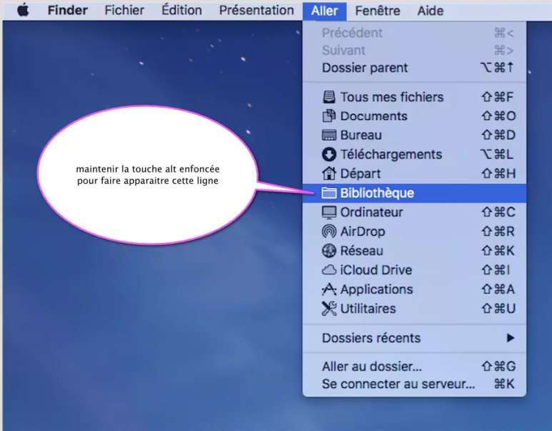

Ensuite, il faut retrouver le dossier de votre boîtier :

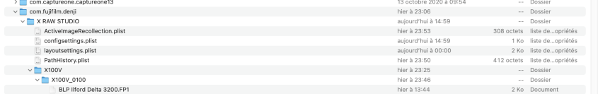

Le même chemin, en dessin :

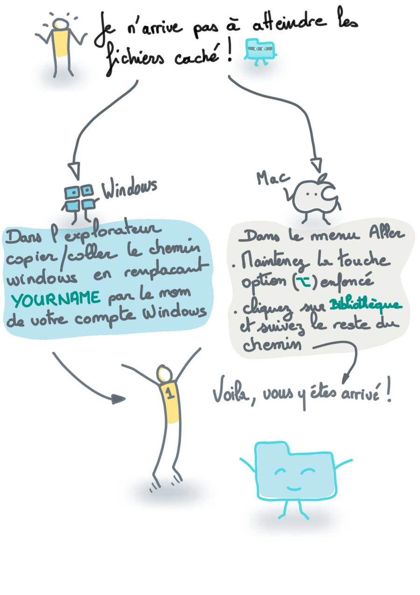

## Téléchargements

- Les presets et le tableur : [la page des presets](https://thomashammoudi.com/presets-fujifilm/) ou [ce dépôt](../README.md).
- Les bases Notion montrées dans la vidéo restent sur [l'ancienne page Notion](https://thomashammoudi.notion.site/Documentation-preset-Fujifilm-a68e0d6ce170416987ad458475cca9ec).

## Procédure pour les autres appareils

Depuis 2026, cette procédure ne sert plus pour les boîtiers courants : tous les fichiers sont déjà convertis dans [la dernière version du dépôt](https://github.com/ThomasHMD/fuji-xrfc-preset-generator/releases/latest), fichier `presets-fp1-autres-boitiers.zip`. Elle reste utile pour un boîtier qui n'y figure pas.

La vidéo présente un résultat fonctionnel pour le X-T4. **Les fichiers ne sont pas directement exploitables sur les autres appareils** : il faut de petites corrections pour que ça marche chez vous.

Avant de vous lancer, regardez si ce que vous cherchez n'est pas déjà dans [le dossier partagé du Discord](#accéder-au-dossier-partagé-du-discord).

### Vérifications préalables

**Votre appareil doit être compatible.** Fujifilm tient [la liste des appareils compatibles avec X RAW Studio](https://fujifilm-x.com/fr-fr/support/compatibility/software/x-raw-studio/). Ceux qui n'y sont pas ne peuvent pas bénéficier du transfert des fichiers FP1. En 2022, la liste était :

GFX100, GFX100S, GFX50S II, GFX 50S, GFX 50R, X-H1, X-Pro3, X-Pro2, X-T4, X-T3, X-T2, X-S10, X-T30 II, X-T30, X-T20, X-E4, X-E3, X100V, X100F.

**Votre appareil doit être à jour.** Un appareil non mis à jour peut ne pas être reconnu par X RAW Studio, comme le décrit [cet article](https://photography.tutsplus.com/tutorials/profile-raw-photos-in-xraw--cms-37087). Les mises à jour sont [sur le site de Fujifilm](https://fujifilm-x.com/global/support/download/firmware/cameras/).

### Procédure 1 : corriger les fichiers FP1

C'est celle que je montre dans la vidéo. Elle consiste à corriger les fichiers `.FP1` une fois générés, pour qu'ils soient reconnus par votre appareil.

1. Téléchargez [Notepad++](https://notepad-plus-plus.org/downloads/). C'est gratuit, et vous en aurez besoin pour la suite.
2. **Trouvez comment Fujifilm écrit le nom de votre appareil dans l'en-tête du fichier.** Générez un preset bidon avec X RAW Studio et ouvrez-le. Sur l'exemple du X-T2, l'appareil est nommé `X-T2` ou `X-T2_0100` (balise `TetherRAWConditonCode`) : ce sont ces valeurs qu'il faut reprendre.

   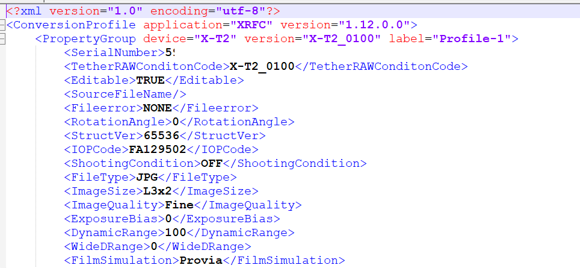

3. Ouvrez dans Notepad++ tous les fichiers FP1 à convertir. Dans les fichiers fournis, ce sont les valeurs `X-T4` et `X-T4_0100` qu'il faut changer.

   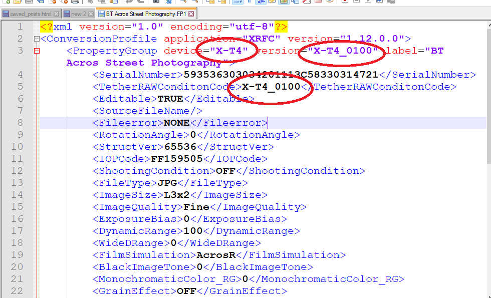

4. Faites `Ctrl+F`, allez dans Replace, et remplacez le nom de l'appareil par le vôtre dans tous les documents ouverts.

   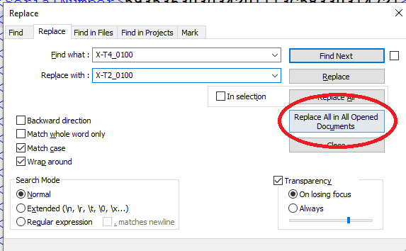

5. **Redémarrez X RAW Studio.** Le preset apparaît dans la liste.

   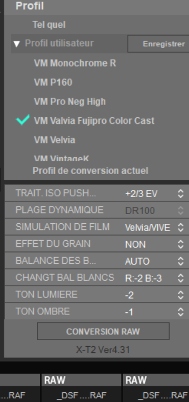

### Procédure 2 : mettre à jour la macro pour votre appareil

C'est une **alternative** : vous faites la 1 **ou** la 2, selon votre préférence et vos compétences techniques.

Elle consiste à corriger l'outil qui génère les presets plutôt que les fichiers eux-mêmes. Elle est plus efficace, parce qu'elle donne directement des fichiers corrects (notamment pour les balises décrites plus bas), mais elle demande plus de compétences techniques.

Le tableur contient une macro qui génère un fichier FP1 par ligne. Elle est prévue pour le X-T4 : si vous avez ce modèle, vous n'avez rien à faire. Pour un autre modèle, ouvrez les macros d'Excel (Affichage > Macros) et remplacez `X-T4` par `X-T2`, par exemple. Si vous ne connaissez pas le nom de votre appareil « dans le langage de Fujifilm », générez un preset bidon avec X RAW Studio et regardez comment il est nommé dans le fichier.

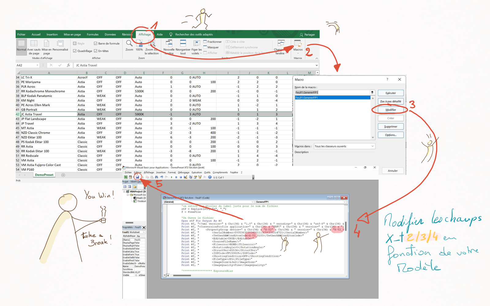

### Le numéro de série

Il faut changer le nom de l'appareil dans le fichier, mais **pas le numéro de série** : X RAW Studio ne le prend pas en compte.

On peut donc s'échanger très facilement des fichiers FP1 d'un même appareil : si un ami a un X-Pro3 et vous aussi, vous pouvez récupérer ses fichiers et vous en servir directement.

## Autres corrections

Selon votre modèle, ces corrections sont parfois nécessaires.

### Tableau de correspondance des films

Entre certaines générations d'appareils, le nom des simulations de film change. Par exemple, `NEGA` (sur X-T4) devient `NEGAStd` sur X-T2. Vérifiez ce point en corrigeant le tableur avant de lancer la génération. Si le nom n'est pas bon, une simulation par défaut est appliquée (Provia, de mémoire).

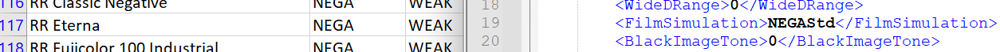

| Nom en langage humain | Dans le XML du X-T2 | Dans le XML du X-T4 |
|---|---|---|
| Acros | `Acros` | `Acros` |
| Acros + filtre jaune | `AcrosYe` | `AcrosY` |
| Acros + filtre rouge | `AcrosR` | `AcrosR` |
| Acros + filtre vert | `AcrosG` | `AcrosG` |
| Astia | `Astia` | `Astia` |
| Classic Chrome | `Classic` | `Classic` |
| Classic Neg. | absent | `ClassicNEGA` |
| Eterna | absent | `Eterna` |
| Monochrome | `BW` | `BW` |
| Monochrome + filtre jaune | `BYe` | `BYe` |
| Monochrome + filtre rouge | `BR` | `BR` |
| Monochrome + filtre vert | `BG` | `BG` |
| PRO Neg. Hi | `NEGAhi` | `NEGAhi` |
| PRO Neg. Std | `NEGAStd` | `NEGA` |
| Provia | `Provia` | `Provia` |
| Sépia | `Sepia` | `Sepia` |
| Velvia | `Velvia` | `Velvia` |

### Différences de balises

Certains paramètres du X-T4 n'existent pas sur le X-T2. Il ne faut pas les mettre sur `OFF`, le logiciel ne les reconnaîtrait pas : **il faut une balise vide**. Par exemple, `<ColorChromeBlue>OFF</ColorChromeBlue>` devient `<ColorChromeBlue/>`.

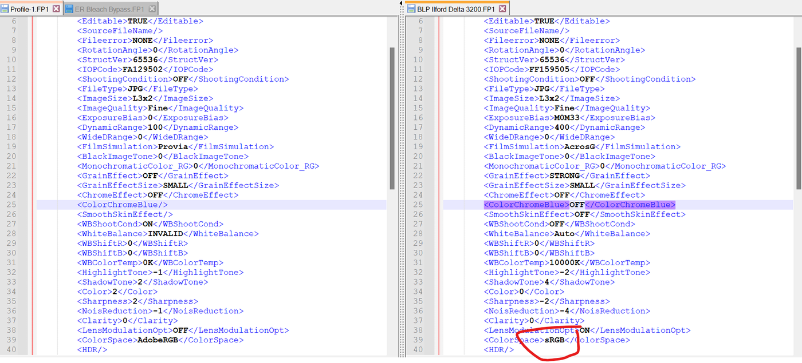

### « Preset non applicable »

Certains presets apparaissent bien dans X RAW Studio, mais ne sont pas sélectionnables. Cela vient souvent du nom du preset : un caractère spécial semble poser problème. Pour corriger, éditez le fichier FP1 et changez l'attribut `label` de la balise `PropertyGroup`.

## Données par appareil

### X-T1

Le X-T1 n'est pas compatible avec X RAW Studio. Vous pouvez tout de même repartir de la liste du tableur pour essayer des recettes à la main.

## Utiliser les presets d'un autre appareil dans Lightroom

On peut utiliser dans Lightroom les simulations exclusives d'un appareil Fujifilm sur un autre, comme le montre [cette vidéo](https://www.youtube.com/watch?v=UUce-04DoSM).

Les trois fichiers à modifier sont ici :

- **Mac** : Applications > Adobe Lightroom Classic > clic droit, Afficher le contenu du paquet > Contents > Resources > Settings > Adobe > Profiles > Camera > Fujifilm > Fujifilm X-T4 ;
- **Windows** : `C:\ProgramData\Adobe\CameraRaw\Settings\Adobe\Profiles\Camera\Fujifilm\Fujifilm X-T4`.

On ouvre chaque fichier dans Notepad++ et on y change le nom de l'appareil (ligne `crs:CameraModelRestriction`).

## Les outils

### Accéder au Discord

[Rejoindre le Discord](https://discord.com/invite/tnCpAZy). Un fil est dédié à ce sujet, et le rôle « Team Fuji » permet de mentionner les membres actifs pour poser vos questions. Pour le rejoindre, allez dans le salon « règles-et-sélection-des-rôles » et cliquez sur la petite montagne.

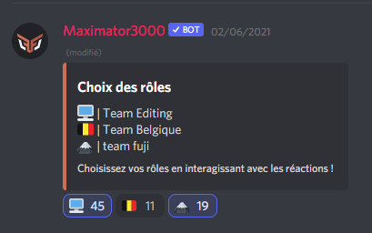

### Accéder au dossier partagé du Discord

Sur le Discord, les membres s'échangent les fichiers FP1 qu'ils créent pour chaque appareil. Pour accéder au [dossier partagé](https://www.dropbox.com/sh/ucprs9lx87hkq74/AADjCMeOb3zUcvVGzDeUI2I-a?dl=0), demandez une invitation dans le fil dédié, ou taguez la Team Fuji.

Pour le nommage :

- mettez vos fichiers dans le dossier de votre appareil, et créez-le s'il n'existe pas ;
- renommez votre preset « Votre nom - Nom du preset » si vous voulez qu'on sache qui a fait quoi.

### FujiSimuRecipesGen

Pour ceux qui n'ont pas Excel ou qui ne sont pas sous Windows, un membre du Discord a écrit [FujiSimuRecipesGen](https://github.com/mmoqui/FujiSimuRecipesGen), un petit programme en Go qui génère des fichiers FP1 à partir d'un CSV. Il est sous licence MIT.

## Le travail d'Henri-Pierre Chavaz

Dans [un article de blog](https://hpchavaz-photography.blogspot.com/p/fujifims.html), Henri-Pierre Chavaz a effectué un travail similaire. Certaines sources sont communes (Fuji X Weekly), d'autres viennent de YouTube notamment.

Il a [mis ses fichiers FP1 en ligne](https://www.dropbox.com/sh/dj91iz5bzq5akt4/AACFjU4fj1DiPuiAcgXVkHA9a?dl=0). Comme il l'indique [sur son blog](https://hpchavaz-photography.blogspot.com/p/fujifilm-miscellaneous.html#XRawStudio), c'est Donald M. Falls qui en est l'auteur : il les a publiés après un travail collaboratif, dans le groupe Facebook « Fujifilm Film Simulation ». J'en ai fait une copie dans le dossier partagé du Discord, au cas où ils soient un jour supprimés.

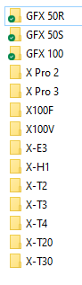

## Pour le X-T5

Les fichiers pour le X-T5 sont dans `presets-fp1-autres-boitiers.zip`, sur [la dernière version du dépôt](https://github.com/ThomasHMD/fuji-xrfc-preset-generator/releases/latest). Un utilisateur avait aussi réalisé une intégration pour le X-T5 : sa documentation est restée sur [l'ancienne page Notion](https://thomashammoudi.notion.site/Documentation-preset-Fujifilm-a68e0d6ce170416987ad458475cca9ec).

## Contribuer

Une correction, un appareil à ajouter ? Ouvrez une [issue](https://github.com/ThomasHMD/fuji-xrfc-preset-generator/issues) ou une pull request sur ce dépôt, ou passez par le Discord.
