# Le traitement des couleurs du Fujifilm X-T4, réglage par réglage

Que fait vraiment « Ombres +2 » ? Sur quelles couleurs agit le Color Chrome ? Pourquoi le décalage de balance ne remplace-t-il pas un filtre en noir et blanc ? Cette page répond avec des mesures, pas avec des impressions.

**Comment c'est mesuré, en une phrase.** Le X-T4 a développé lui-même les mêmes fichiers RAW des milliers de fois, en changeant un seul réglage à la fois ; chaque JPEG est comparé au précédent, zone par zone (1 000 zones par photo), en clarté (L\*), en saturation (chroma C\*) et en teinte, dans l'espace CIELAB. Au total, 21 658 développements de 16 photos variées, plus une série d'illustrations sur des photos sans personne.

**Ce que valent les chiffres.** Ce sont des médianes : sur une photo donnée, l'effet peut s'écarter un peu de la médiane. Un écart de 1 en L\* se devine à peine, 3 se voit côte à côte, 10 saute aux yeux. Seul le X-T4 a été mesuré : les boîtiers de la même génération (capteur X-Trans 4, processeur X-Processor 4) ont les mêmes réglages et se comportent probablement de la même façon, sans que ce soit vérifié. Chaque section dit si un chiffre est **vérifié** (mesuré directement) ou **calculé** (tiré des mesures par un calcul).

## Sommaire

1. [Où agit chaque réglage, en un tableau](#1-où-agit-chaque-réglage-en-un-tableau)
2. [La courbe de base](#2-la-courbe-de-base)
3. [Les simulations de film](#3-les-simulations-de-film)
4. [Hautes lumières et ombres](#4-hautes-lumières-et-ombres)
5. [Couleur](#5-couleur)
6. [Color Chrome Effect et Color Chrome FX Blue](#6-color-chrome-effect-et-color-chrome-fx-blue)
7. [Balance des blancs et décalage R / B](#7-balance-des-blancs-et-décalage-r--b)
8. [Le noir et blanc : Acros, Monochrome, filtres, virage](#8-le-noir-et-blanc--acros-monochrome-filtres-virage)
9. [Plage dynamique](#9-plage-dynamique)
10. [Clarté, netteté, réduction du bruit, grain](#10-clarté-netteté-réduction-du-bruit-grain)
11. [Ce que le boîtier ne sait pas faire](#11-ce-que-le-boîtier-ne-sait-pas-faire)
12. [Ce qu'on en tire pour écrire une recette](#12-ce-quon-en-tire-pour-écrire-une-recette)

## 1. Où agit chaque réglage, en un tableau

| Réglage | Ce qu'il touche | Ce qu'il laisse | Ampleur au maximum |
|---|---|---|---|
| **Simulation de film** | saturation, teintes par famille de couleur, courbe de base ; en N&B, le mélange des couleurs | rien : c'est le réglage le plus large | chroma × 0,54 (Classic Neg.) à × 1,35 (Velvia) par rapport au Provia |
| **Hautes lumières** | la clarté au-dessus de L\* 60 environ | tout ce qui est sous L\* 45, la teinte | −6 / +11 L\* (de −2 à +4) |
| **Ombres** | la clarté sous L\* 45 environ | tout ce qui est au-dessus de L\* 60, la saturation | −15 / +8 L\* |
| **Couleur** | la saturation, partout, en proportion | la clarté, presque toute la teinte | × 0,80 à × 1,20 |
| **Color Chrome Effect** | assombrit les couleurs saturées, dans les ombres et les tons moyens | les gris, les bleus, tout ce qui est au-dessus de L\* 45 | jusqu'à −5 L\* (fort) |
| **Color Chrome FX Blue** | assombrit les bleus, d'autant plus qu'ils sont saturés | toutes les autres couleurs | jusqu'à −26 L\* sur les bleus très saturés (fort) |
| **Balance des blancs** (Kelvin, préréglages) | la teinte de toute l'image | la clarté (±1 L\*) | b\* de −42 (2 500 K) à +25 (10 000 K) par rapport à Auto |
| **Décalage R / B** | en couleur, une dominante sur toute l'image (et un peu de clarté pour R) ; en N&B, une exposition | en N&B, le mélange des couleurs | dominante de 20 à 33 unités de a\* ou b\* à ±9 |
| **Virage** (N&B) | la teinte de toute l'image | la clarté (moins de 0,4 L\*) | a\* ou b\* de 11 à 14 à ±9 |
| **Plage dynamique** | les hautes lumières, retenues, si elle est choisie à la prise de vue | les tons moyens (±0,6 L\*) | hautes lumières −1,4 à −3,7 L\* de DR100 à DR200, −5 à −7 de DR100 à DR400 |
| **Clarté** | le contraste local (la texture) | les tons et les couleurs moyens des zones | moins de 0,4 L\* sur les moyennes, hors noirs profonds |
| **Netteté, réduction du bruit, grain** | le détail fin | les tons et les couleurs | |

Les sections suivantes donnent le détail.

## 2. La courbe de base

Avant tout réglage, le Provia neutre (tout à 0) place les tons ainsi, en IL autour du gris moyen de la scène (calculé, sur les 16 photos) :

| Scène | −2 IL | −1 IL | gris 18 % | +1 IL | +2 IL | +3 IL |
|---|---|---|---|---|---|---|
| Provia, L\* rendu | 23 | 37 | 54 | 68 | 84 | 96 |
| Acros | 21 | 36 | 54 | 69 | 85 | 97 |
| Classic Neg. | 22 | 34 | 57 | 76 | 91 | 98 |

Un gris de 18 % sort à L\* 54, un peu plus clair que dans la scène (L\* 50), et les hautes lumières se tassent doucement au-dessus de +2 IL. Classic Neg. éclaircit nettement les tons moyens et les hautes lumières (+4 à +8 L\*) : à exposition égale, l'image paraît surexposée de 1/3 à 1/2 IL (calcul). Sous −2 IL, l'estimation de la scène n'est pas assez fiable pour être publiée.

## 3. Les simulations de film

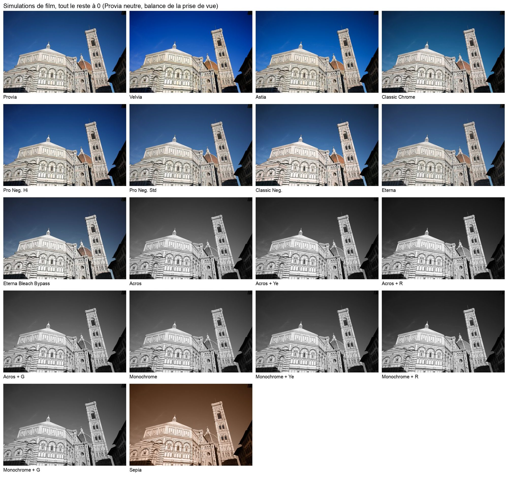

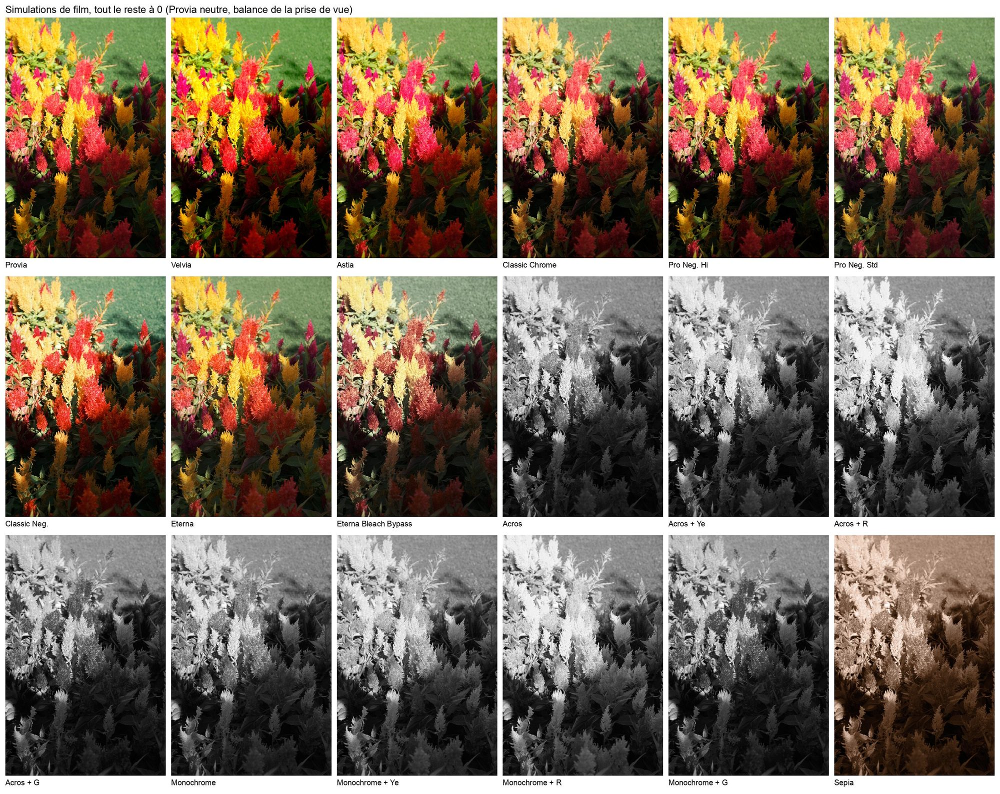

Chaque simulation est un ensemble : une saturation, des glissements de teinte par famille de couleur et une courbe. Par rapport au Provia, tous les autres réglages égaux (médianes de 120 à 136 paires de développements, calcul) :

| Simulation | Saturation (chroma) | Tons | Teintes |
|---|---|---|---|
| **Velvia** | × 1,26 à × 1,35 | ombres plus denses (−3 L\*) | oranges vers le jaune (+7°), bleus vers le violet (+8°) |
| **Astia** | × 1,04 à × 1,13 | douce : hautes lumières −1, ombres −2 | oranges vers le jaune (+5°), verts vers le jaune (−4°) |
| **Classic Chrome** | × 0,71 à × 0,81 | ombres plus denses (−3 à −2), tons clairs +2 | **bleus vers le cyan (−13°)**, jaunes vers l'orange (−5°) |
| **Pro Neg. Hi** | × 0,93 à × 0,97 | plus de contraste dans les ombres (−4 à −3) | rouges, verts et magentas légèrement déplacés (±4°) |
| **Pro Neg. Std** | × 0,81 à × 0,91 | douce, ombres +1 | rouges vers le magenta (−6°) |
| **Eterna** | × 0,70 à × 0,79 | la plus plate : ombres +4, hautes lumières −3 | bleus vers le cyan (−6°) |
| **Classic Neg.** | × 0,54 à × 0,71 (le plus fort sur les couleurs peu saturées) | tons moyens et clairs **+4 à +7**, ombres −3 | **rouges vers l'orange (+14°), verts vers le cyan (+18°), magentas vers le rouge (+18°)** |

Lecture des teintes : l'angle de teinte tourne du rouge vers le jaune, le vert, le cyan, le bleu, le magenta, puis revient au rouge ; « +13° » est un pas dans ce sens.

**Contre la scène** cette fois, et non plus contre le Provia : chaque simulation seule, tout le reste à 0, sur 16 photos (calcul). Le contraste est la pente de la courbe autour du gris, de −1 à +1 IL de scène ; la saturation, le rapport entre la chroma rendue et celle de la scène, famille par famille (1 = la saturation de la scène) :

| Simulation, contre la scène | Contraste (L\* par IL autour du gris) | Saturation : rouges ; jaunes ; verts ; bleus |
|---|---|---|
| **Eterna Bleach Bypass** | **22,0** | **0,41 ; 0,58 ; 0,48 ; 0,26** |
| Classic Neg. | 21,1 | 0,72 ; 0,96 ; 0,75 ; 0,36 |
| Classic Chrome | 17,3 | 0,80 ; 1,00 ; 0,83 ; 0,52 |
| Pro Neg. Hi | 15,9 | 0,79 ; 1,11 ; 1,06 ; 0,79 |
| Provia | 15,7 | 0,96 ; 1,25 ; 1,18 ; 0,79 |
| Astia | 15,6 | 0,95 ; 1,34 ; 1,14 ; 0,86 |
| Pro Neg. Std | 15,5 | 0,72 ; 1,00 ; 0,99 ; 0,69 |
| Eterna | 15,4 | 0,68 ; 0,88 ; 0,79 ; 0,54 |
| Velvia | 14,7 | 1,06 ; 1,53 ; 1,41 ; 1,25 |
| Acros, Monochrome (avec ou sans filtre), Sépia | 15,8 à 16,9 | noir et blanc |

- **Eterna Bleach Bypass** est la plus contrastée et la moins saturée, dans toutes les familles : le tirage sans blanchiment dont elle porte le nom.
- **Classic Neg.** la suit de près en contraste (21,1) et, contre la scène, tourne les rouges et les bleus de +18 à +20°.
- Les **bleus** sont la famille la moins saturée dans presque toutes les simulations ; seul le Velvia les sature.
- **Sépia** suit la courbe de Monochrome (15,8 contre 15,9).

Ce qu'il faut en retenir :
- **Classic Chrome** ne fait pas qu'éteindre les couleurs : il tourne les bleus vers le cyan, d'où ses ciels.
- **Classic Neg.** est la simulation qui transforme le plus. Elle éclaircit, désature fortement les couleurs déjà ternes, et fait tourner trois familles de couleur à la fois.
- **Eterna** est la seule qui relève les ombres et baisse les hautes lumières en même temps : une courbe de cinéma, faite pour être retouchée.
- **Velvia** sature fortement (× 1,3) et ne tourne presque pas les rouges (+3°).

## 4. Hautes lumières et ombres

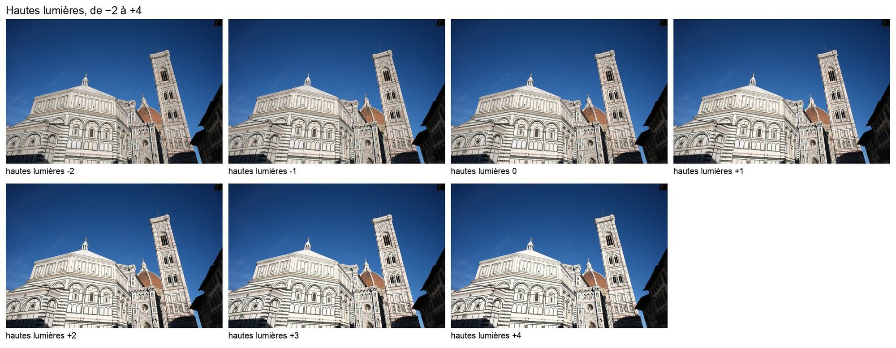

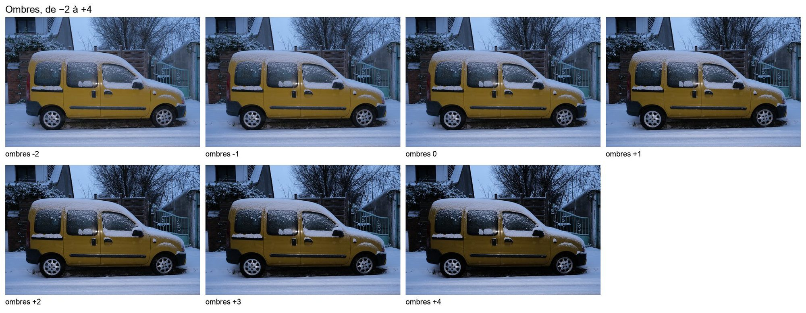

**Deux réglages qui ne se chevauchent pas.** Hautes lumières n'agit qu'au-dessus de L\* 60 environ, Ombres qu'en dessous de L\* 45. Entre les deux, **les tons moyens (L\* 45 à 60) ne bougent presque pas**. Vérifié ; les chiffres ci-dessous sont des médianes de 48 à 712 paires de développements selon le cas (calcul).

Écart de clarté (L\*) par tranche de clarté de l'image, en couleur :

| Hautes lumières | −2 | −1 | +1 | +2 | +3 | +4 |
|---|---|---|---|---|---|---|
| L\* 45 à 60 | −0,1 | 0 | +0,1 | +0,2 | +0,4 | +0,6 |
| L\* 60 à 75 | −3,0 | −1,4 | +2,3 | +4,3 | +7,5 | +10,3 |
| L\* 75 à 90 | −6,0 | −2,8 | +3,1 | +5,8 | +8,3 | +10,6 |
| L\* 90 à 100 | −4,0 | −2,0 | +1,4 | +2,7 | +3,5 | +4,3 |

| Ombres | −2 | −1 | +1 | +2 | +3 | +4 |
|---|---|---|---|---|---|---|
| L\* 0 à 15 | +7,8 | +4,1 | −2,8 | −5,0 | −6,2 | −7,1 |
| L\* 15 à 30 | +8,0 | +4,1 | −3,8 | −7,7 | −10,8 | −13,7 |
| L\* 30 à 45 | +4,0 | +2,1 | −2,9 | −6,0 | −10,2 | −14,7 |
| L\* 45 à 60 | 0 | 0 | 0 | 0 | 0 | 0 |

Ce que montrent ces tableaux :
- **Les valeurs positives durcissent, les négatives adoucissent**, dans les deux cas : Hautes lumières +4 éclaircit les clairs, Ombres +4 fonce les sombres.
- **Le blanc pur et le noir pur bougent peu** (L\* 90 à 100 : 4 au plus) : la courbe se plie au milieu de sa moitié, pas aux extrémités.
- **Les couleurs gardent leur saturation** : sur les zones claires et saturées, Hautes lumières +4 éclaircit autant que sur les gris (+10,7 contre +11,2) et ne retire que 2,6 de chroma. Le boîtier agit sur la clarté, pas canal par canal (calcul).
- En noir et blanc, l'effet est un peu plus faible (Hautes lumières +4 : +7 au lieu de +10,6).
- Les demi-crans (+1,5) passent ; les valeurs hors de −2 à +4 sont ignorées (rendu identique à 0), sans butée.

## 5. Couleur

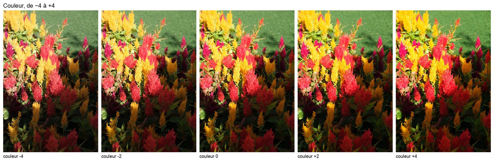

Le réglage Couleur **multiplie la saturation**, à peu près de 5 % par cran, sans toucher la clarté (calcul, 40 à 248 paires) :

| Couleur | −4 | −2 | +2 | +4 |
|---|---|---|---|---|
| Chroma | × 0,80 | × 0,90 | × 1,10 | × 1,20 |

- Le facteur est le même de L\* 0 à 90 (× 1,16 à × 1,20 à +4) : c'est une saturation proportionnelle, pas un « vibrance » qui ménagerait les couleurs déjà fortes.
- Les couleurs très saturées montent moins (× 1,11 à +4) : elles touchent la limite du sRGB.
- La teinte bouge à peine : les jaunes glissent de 1,4° vers l'orange à +4, les bleus et les rouges d'environ 1°.
- La clarté ne change pas (moins de 0,7 L\*).

## 6. Color Chrome Effect et Color Chrome FX Blue

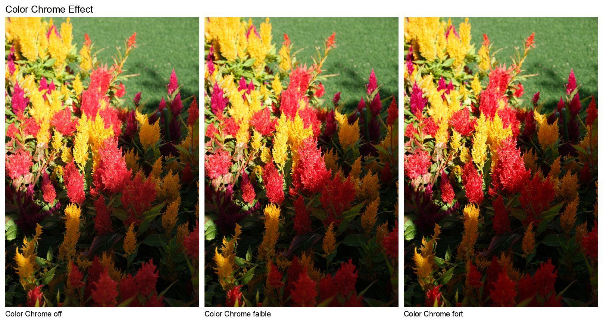

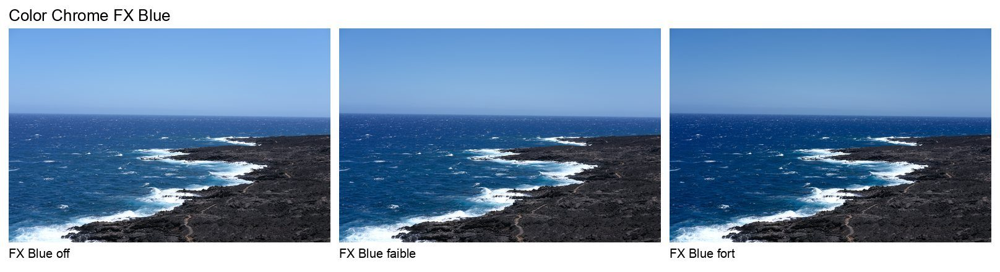

**Color Chrome Effect assombrit les couleurs saturées ; il ne les sature pas** (calcul, 192 paires). Sur les zones de chroma supérieur à 25 :

| | L\* 0 à 15 | 15 à 30 | 30 à 45 | 45 à 60 | au-dessus |
|---|---|---|---|---|---|
| faible | −1,3 | −0,8 | −0,8 | 0 | 0 |
| fort | −3,5 | −4,7 | −4,7 | −0,3 | 0 |

- Le chroma ne bouge pas (+0,04) : c'est de la densité, comme une couleur imprimée plus épaisse.
- Il ne touche **ni les gris, ni les bleus, ni les tons clairs**. Par famille, en fort : jaunes −5,3, rouges −2,3, verts −1,8, oranges et magentas −1,5, bleus 0.
- Le faible est discret (moins de 1,5 L\*) ; c'est le fort qui se voit.

**Color Chrome FX Blue ne touche que les bleus** (calcul, 32 paires seulement : chiffres moins sûrs). Il les assombrit d'autant plus qu'ils sont saturés :

| Chroma du bleu | 10 à 25 | 25 à 40 | 40 à 60 | plus de 60 |
|---|---|---|---|---|
| faible | −1,3 | −4,0 | −9,8 | −13,0 |
| fort | −2,7 | −8,1 | −19,8 | −25,7 |

- Les autres couleurs saturées : 0. Les magentas proches du bleu : −0,8 (faible), −1,9 (fort).
- Les bleus gagnent un peu de saturation (+0,5) et glissent d'un demi-degré vers le violet.
- Un ciel bleu profond fonce donc beaucoup en fort ; un ciel pâle presque pas.

**En noir et blanc, ni l'un ni l'autre n'a d'effet** (vérifié, écart nul dans toutes les familles), même si le fichier les note.

## 7. Balance des blancs et décalage R / B

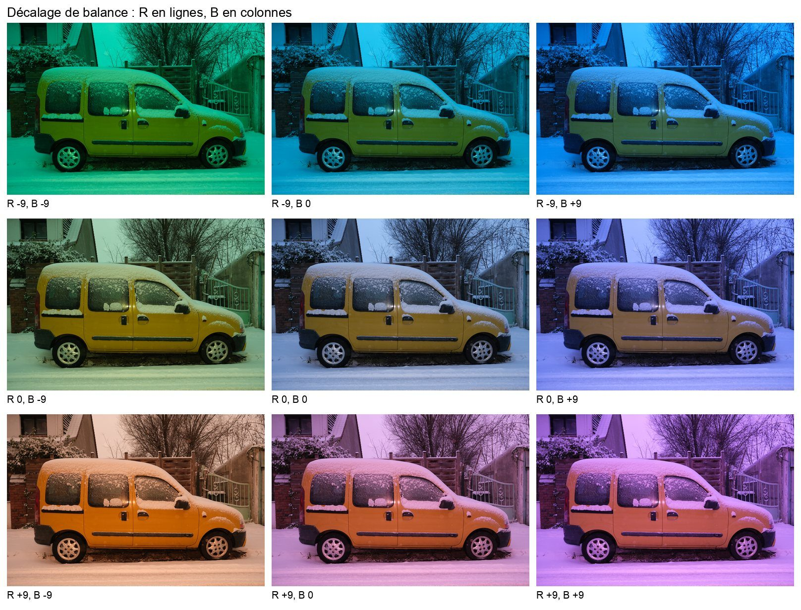

**En couleur**, le décalage pose une dominante sur toute l'image. Sur les gris (calcul, 40 paires ; dans chaque case, la valeur pour + puis pour −) :

| Décalage | ±3 | ±6 | ±9 |
|---|---|---|---|
| R : a\* (rouge + / vert −) | +3,5 / −4,0 | +9,5 / −9,3 | +21,9 / −19,7 |
| B : b\* (bleu = b\* négatif) | −4,1 / +5,6 | −10,9 / +14,7 | −24,2 / +33,4 |

- **L'effet n'est pas linéaire** : les trois premiers crans sont discrets, les derniers forts. ±1 à ±3 corrige, ±6 à ±9 colore.
- R éclaircit aussi l'image (+3 L\* à R +9, −3 à R −9) ; B touche à peine la clarté.
- B tire aussi vers le magenta (B +9 : a\* +10), et R un peu vers le jaune.

**En noir et blanc, le décalage n'est pas un filtre** (vérifié). R ±9 change la clarté de ±3 à ±5 L\*, B ±9 de −2 à +1, **presque autant pour toutes les couleurs**. Le décalage agit comme une exposition (plus fort dans les tons moyens), pas comme un mélange des couches. Pour changer le rendu des rouges ou des bleus en N&B, il faut un filtre (§ 8).

**La balance en Kelvin, en noir et blanc**, fait de même (vérifié, 5 photos). De 10 000 K à 2 500 K, l'image s'assombrit de 4 à 6 L\*, surtout dans les hautes lumières. Par rapport aux gris, l'effet sur le mélange reste faible : jaunes −1,2, bleus −1,4, rouges 0.

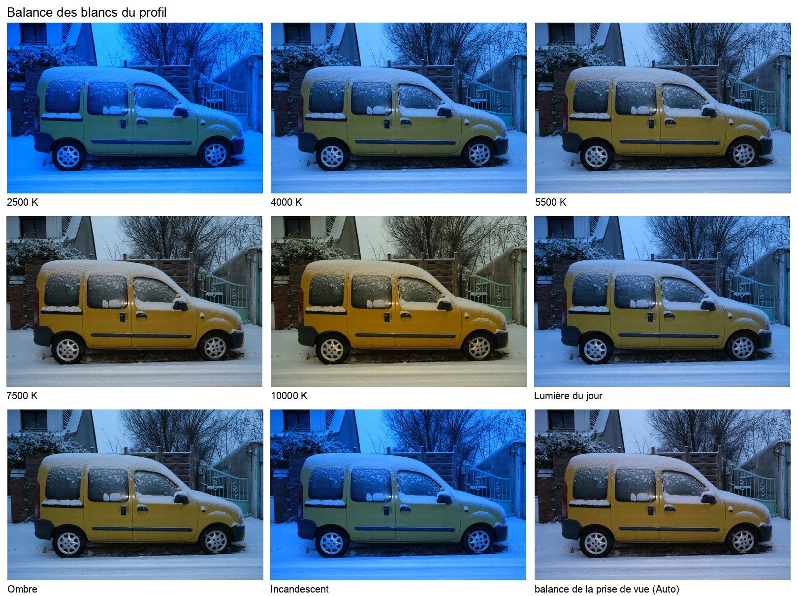

**La balance des blancs du profil, en couleur** (Classic Chrome neutre ; calcul). Par rapport à la balance Auto, sur l'image entière et sur les zones neutres de la vue en Auto (4 435 zones ; en Auto, a\* +0,2 et b\* −2,4) :

| Balance du profil | Image entière, contre Auto : ΔL\* ; Δa\* ; Δb\* | Zones neutres : a\* ; b\* |
|---|---|---|
| 2 500 K | −1,1 ; +14,9 ; −42,5 | +14,3 ; −32,6 |
| Incandescent | −1,1 ; +9,5 ; −34,3 | +7,5 ; −23,7 |
| 4 000 K | −1,0 ; +3,1 ; −21,5 | +2,0 ; −14,2 |
| Lumière du jour | −0,8 ; +0,1 ; −10,8 | +0,2 ; −7,9 |
| 5 500 K | −0,6 ; −0,8 ; −6,5 | −0,1 ; −5,4 |
| Ombre | −0,6 ; −3,0 ; −2,0 | −0,6 ; −3,1 |
| 7 500 K | +0,1 ; −3,4 ; +10,2 | −0,3 ; +0,7 |
| 10 000 K | +0,8 ; −4,3 ; +24,8 | −0,1 ; +6,2 |

- La balance change la teinte de toute l'image (b\* de −42 à +25), presque pas sa clarté (±1 L\*).
- Sur cette vue, 7 500 K tombe presque neutre et 5 500 K reste un peu plus froid que l'Auto. Lumière du jour se place près de 5 500 K, Incandescent entre 2 500 et 4 000 K.
- **Les recettes TH n'utilisent pas de Kelvin.** En noir et blanc (Tri-X, HP5, FP4, de 3 200 à 6 500 K, choisi sur une moitié des photos, noté sur l'autre), aucun Kelvin ne gagne 0,3 : elles restent en Auto, avec des décalages R / B.

## 8. Le noir et blanc : Acros, Monochrome, filtres, virage

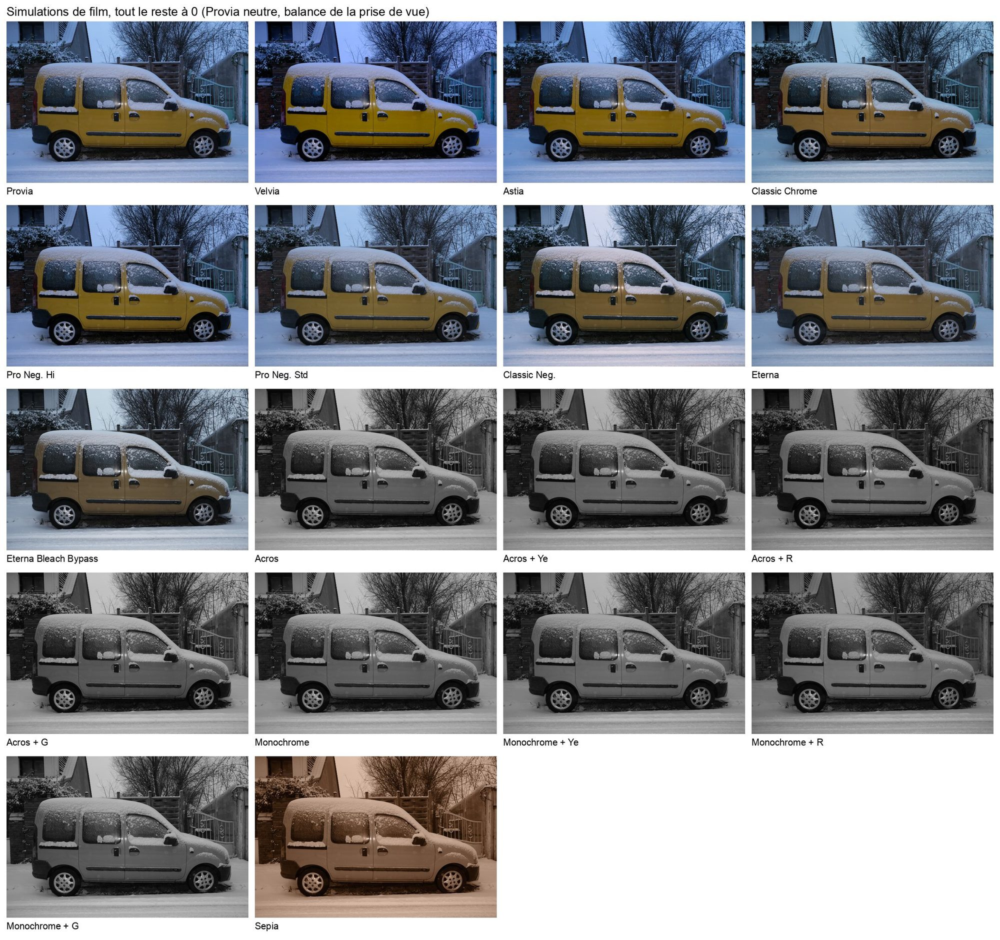

**Le mélange de base.** Rendu en Acros, à clarté de scène égale (L\* 40 à 70), chaque famille de couleur sort ainsi par rapport à sa clarté réelle (calcul) :

| | rouges | oranges | jaunes | cyans | bleus | magentas | gris |
|---|---|---|---|---|---|---|---|
| Acros | −6,3 | −5,6 | +1,3 | −3,9 | +5,2 | +11,0 | +1,8 |
| Monochrome | −7,2 | −6,1 | +0,9 | −3,3 | +4,7 | +8,5 | +1,4 |

Sans filtre, le X-T4 rend donc **les rouges plus sombres et les bleus plus clairs** qu'on ne les voit, comme un film panchromatique sensible au bleu. C'est pour cela qu'un ciel bleu pâlit sans filtre. (L'estimation de la clarté réelle passe par un calcul de la scène, à 1,4 de ΔE près sur une mire.)

**Acros contre Monochrome** : Acros fonce les tons clairs (−3,4 L\* de L\* 60 à 75, −1,7 de 75 à 90), un peu plus les bleus (−2,3), et éclaircit à peine les ombres (+0,5 à +0,8). Il est plus dense et plus contrasté dans les clairs.

**Les filtres**, par rapport à la même simulation sans filtre (Acros et Monochrome se comportent pareil ; calcul, 496 à 667 paires) :

| Filtre | rouges | oranges | jaunes | verts | cyans | bleus | magentas |
|---|---|---|---|---|---|---|---|
| Jaune (Ye) | +5,0 | +4,1 | +4,6 | +0,8 | −1,9 | −3,6 | −1,4 |
| Rouge (R) | +9,8 | +7,9 | +8,8 | +1,3 | −3,7 | −6,8 | −0,7 |
| Vert (G) | −5,1 | −4,3 | −4,5 | 0 | +0,4 | −0,2 | −3,2 |

- Le filtre rouge **double** le filtre jaune, dans les deux sens : rouges et jaunes éclaircis, bleus foncés.
- Le filtre vert **fonce les rouges et les jaunes sans éclaircir les verts** : il sert d'abord à densifier les tons chauds (la peau, les briques).
- Les gris bougent à peine (moins de 1 L\*) : un filtre ne change pas l'exposition générale.

**Le virage** (chaud / froid, magenta / vert) teinte l'image entière sans toucher les tons. Mesuré en Acros, sur les zones de L\* 20 à 90 (calcul) :

| Virage, en Acros | −9 | −6 | −3 | +3 | +6 | +9 |
|---|---|---|---|---|---|---|
| chaud / froid : b\* | −11,1 | −6,8 | −4,2 | +4,5 | +9,2 | +14,3 |
| magenta / vert : a\* | +12,6 | +8,5 | +4,5 | −3,7 | −7,1 | −12,1 |

- Chaque cran de chaud / froid vaut environ 1,5 de b\* ; chaque cran de magenta / vert environ 1,4 de a\*, vers le vert quand on monte.
- Chaque virage tire aussi un peu sur l'autre axe (chaud / froid : a\* de −2,4 à +3,8 ; magenta / vert : b\* de −6,0 à +6,1).
- La clarté ne bouge pas (moins de 0,4 L\*). Aucune recette TH n'utilise le virage.

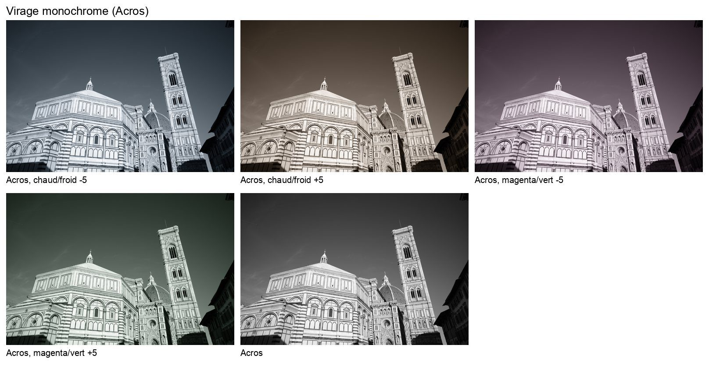

## 9. Plage dynamique

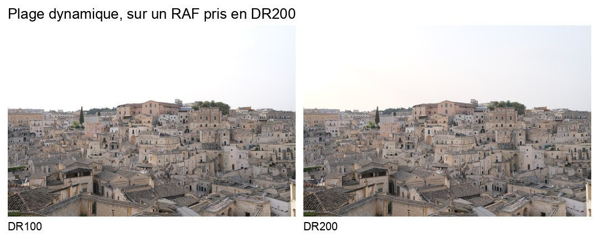

En DR200 et DR400, le boîtier **sous-expose le capteur** de 1 ou 2 IL à la prise de vue, puis relève la courbe au développement pour retrouver la même clarté moyenne. Les hautes lumières gagnent ainsi 1 ou 2 IL de marge (vérifié : biais d'exposition RAW de −1,7 / −2,7 IL en DR200 / 400, contre −0,7 en DR100).

Développer un RAF pris en DR100 en DR200 ou DR400 ne montre donc pas ce que ferait la prise de vue. En N&B, cela relève fortement les tons moyens (+10 L\* en DR200, +28 en DR400) ; en couleur, l'image vire au vert-jaune. Ce n'est pas un réglage de rendu, et il faut le choisir à la prise de vue (vérifié).

**On ne peut pas non plus monter au-dessus de la DR de la prise de vue.** Un RAF pris en DR200 et développé en DR400 sort vert : a\* −37 et b\* +33 en médiane sur la ville de la figure, contre +1,0 et +0,4 en DR100 ; −17 et +36 sur un autre RAF (vérifié). La DR se choisit à la prise de vue ; au développement, on ne peut que la baisser.

La **priorité D-Range** est une courbe de compression (vérifié sur des RAF pris en DR100, en N&B). Elle relève les ombres de +14 (faible) à +29 L\* (fort) et baisse les hautes lumières de 2 à 3.

**Sur des RAF pris en DR200** (7 vues, dont la ville de la figure), développés en DR100 contre DR200 (vérifié) :
- les tons moyens ne bougent pas : médiane de L\* à ±0,6 près, et −0,4 à −0,7 sous L\* 60 ;
- les hautes lumières sont plus claires en DR100 : +1,4 à +3,0 L\* entre L\* 75 et 90, +2,0 à +3,7 au-dessus ;
- les blancs purs (L\* > 97) sont bien plus nombreux en DR100 : 39 % des zones contre 26 % sur la ville, 35 % contre 18 % sur une autre vue, 1 à 4 % contre 0 à 1 % sur les vues peu contrastées.

Sur un RAF pris en DR400, développé en DR100, les hautes lumières montent de +5,0 L\* entre 75 et 90 et de +7,2 au-dessus ; développé en DR200, de +2,0 et +3,0. Une DR plus haute ne change donc que les hautes lumières : elle les retient.

Sur ces mêmes RAF, contre leur DR de prise de vue, la **priorité D-Range** faible relève les ombres (L\* 0 à 30) de +3,7 à +8,3 et baisse les hautes lumières (75 à 90) de 5,7 à 9,3 ; la forte relève les ombres de +16 à +22, baisse les hautes lumières de 3,3 à 7,5, et les noirs (L\* < 5) disparaissent presque (0 à 1,4 % des zones, contre 0 à 22,5 %).

**Les recettes TH restent en DR100.** La règle était fixée avant la mesure : DR200 ou DR400 seulement avec un gain moyen d'au moins 0,3, sur 2 scènes sur 3, prises au trépied à DR100, 200 et 400. Aucune recette ne passe ; la Pro 400H gagne sur les deux scènes valables, mais de 0,12 seulement.

Même test, même règle pour les recettes de 2022 retenues dans les emplacements C1 à C7 : `DC Classic Chrome II`, `NZD Ektar 100` et `RR Acros Push Process`. Aucune ne passe. `RR Acros Push Process` et `NZD Ektar 100`, d'origine en DR200 et DR Auto, y passent donc en DR100. La DR Auto ne se mesure pas ici, faute de vues prises dans ce mode ; même si le boîtier prenait toujours la meilleure DR de chaque scène, le gain resterait sous 0,3 (+0,17 à +0,19, calcul).

## 10. Clarté, netteté, réduction du bruit, grain

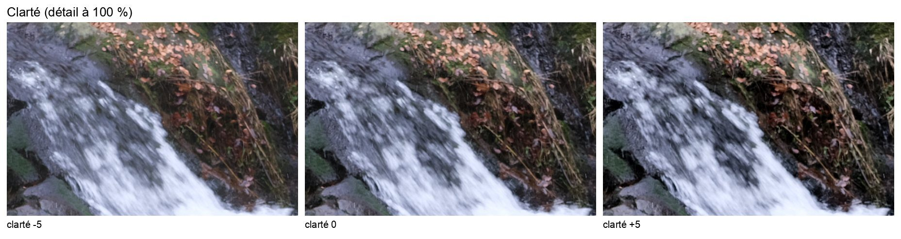

**La clarté ne change ni les tons ni les couleurs moyens** (calcul : moins de 0,4 L\* sur les moyennes de zones, sauf −1,4 dans les noirs à +4 en N&B). Elle agit sur le contraste local, la texture, à une échelle que les moyennes de zones ne voient pas : la figure le montre mieux qu'un chiffre.

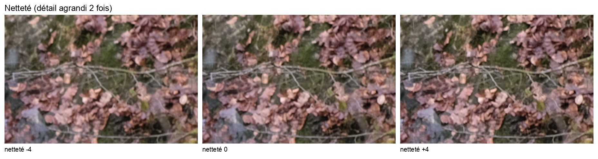

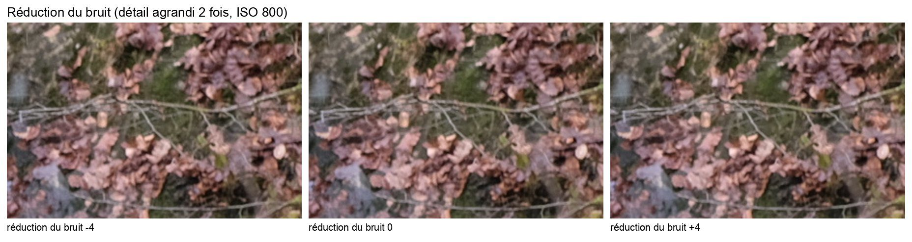

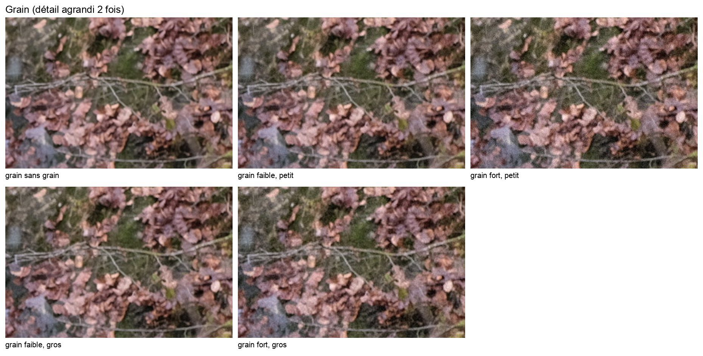

**Le grain** s'ajoute par-dessus le reste (vérifié, mesuré au cercle de 48 µm ramené au 24 × 36, l'ouverture de la granularité des fiches Kodak) :

| Grain | faible, petit | faible, gros | fort, petit | fort, gros |
|---|---|---|---|---|
| σ de L\* ajouté | 0,33 à 0,41 | 0,45 à 0,46 | 0,64 à 0,69 | 0,86 à 0,92 |

- **La réduction du bruit ne retire pas le grain** : à −4, elle laisse passer un peu de bruit du capteur (0,23), qui ne s'ajoute presque pas au grain fort.
- La netteté −4 en retire un peu (0,87 au lieu de 0,92).
- Même au plus fort, le grain du boîtier reste **2,5 fois plus faible que celui d'une Tri-X 400** à la même échelle (2,34). Le grain d'un film argentique ne s'imite pas tout à fait.

## 11. Ce que le boîtier ne sait pas faire

- **Pas de courbe des tons moyens.** Hautes lumières et Ombres s'arrêtent à L\* 60 et L\* 45 ; seule l'exposition déplace les tons moyens.
- **Pas de mélangeur de couches en N&B** : quatre choix (sans filtre, jaune, rouge, vert), rien entre eux. Ni la balance ni le décalage ne s'y substituent (§ 7).
- **Une seule saturation pour toute l'image** : Couleur ne vise aucune teinte, Color Chrome ne vise que les couleurs saturées sombres, FX Blue que les bleus.
- **Pas de valeurs cachées** : au-delà des bornes de l'écran (Hautes lumières +5, Couleur +6), la valeur est ignorée, le rendu revient à 0.
- **Une plage dynamique figée à la prise de vue** : au développement, on ne peut que la baisser (§ 9).
- **Un grain plus fin qu'un film**, comme on l'a vu.

## 12. Ce qu'on en tire pour écrire une recette

- **Tons moyens trop clairs ou trop sombres** : c'est l'exposition, pas Hautes lumières ou Ombres. Les recettes mesurées donnent une consigne d'exposition quand elle aide.
- **Classic Neg.** éclaircit d'environ 1/3 d'IL : une correction de −1/3 IL le compense.
- **Ciel trop clair en N&B** : filtre rouge (bleus −6,8) ou jaune (−3,6) ; pas de décalage B, qui assombrit tout.
- **Peau ou briques plus denses en N&B** : filtre vert (rouges −5,1).
- **Rouges et jaunes profonds sans saturer davantage** : Color Chrome fort. **Ciel bleu plus dense** en couleur : FX Blue, faible d'abord, car l'effet monte vite avec la saturation du bleu.
- **Décalage de balance** : ±1 à ±3 pour corriger, ±6 à ±9 pour un parti pris ; les crans ne sont pas réguliers.
- **Saturer moins sans tout éteindre** : Couleur −2 retire 10 %, partout pareil.

**Ce qu'on peut attendre d'une recette.** Une recette s'inspire de sa cible, elle ne la copie pas : l'écart à la cible est du même ordre que l'écart entre deux recettes. Entre deux recettes couleur, il va de 2,1 à 6,0 ΔE2000, l'écart de couleur tel que l'œil le perçoit (médiane 3,8, sur 36 paires) ; entre une recette et sa cible, de 2,9 à 5,5 en médiane sur 20 photos nouvelles. Ce sont deux calculs différents, image entière sans consigne d'exposition d'un côté, zones uniformes de l'autre : à lire comme des ordres de grandeur (calcul).

---

*Mesures et figures : Thomas Hammoudi, octobre 2026, X-T4 au firmware 2.12. Les outils qui font les mesures et les figures sont dans ce dépôt, [`xt4/outils/`](../xt4/outils/) (`xt4_effets.py`, `xt4_illustrations.py`). Licence CC BY-NC 4.0.*
